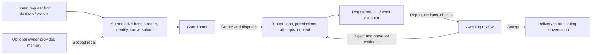

# Luma Harness

[简体中文](README.md) | **English**

**Bring multiple AI agents into a team that can dispatch work, review results, and deliver them back to you.**

Luma is a local-first multi-agent work harness with desktop and mobile web clients. It connects human requests, a coordinator, work executors, task context, review, and conversation delivery in one workflow.

You choose the team size, member names, personas, models, and working directories; Luma provides the collaboration structure. The public release starts with generic configuration and a neutral base interface. An optional oil painting appearance pack is distributed separately.

[](https://github.com/Gavriel-lab/luma-harness/actions/workflows/check.yml)

[Download for Windows](https://github.com/Gavriel-lab/luma-harness/releases/latest) · [Quick start](#quick-start) · [Set up with AI](#give-the-repository-to-your-ai) · [Architecture](docs/ARCHITECTURE.md) · [MIT license](LICENSE)

## Why Luma

When you use several AI agents, work can become scattered across windows: one knows the requirements, another edits files, and a third says the task is done. You still have to inspect the artifacts, relay context, and track progress yourself.

Luma brings these steps into an inspectable workflow. The coordinator creates tickets from your work requests and dispatches them to registered executors. Workers operate with scoped context and directory permissions, then submit artifacts and checks. The coordinator reviews the evidence and delivers accepted results to the originating conversation.

It is for people who want to organize multiple CLIs or agents around a project, access the same conversation from desktop and mobile, and control their own accounts and data. Initial setup requires choosing providers and working directories. Remote phone access also requires deploying your own gateway.

## What you can do

| Capability | How it works |
| --- | --- |
| Multi-agent collaboration | Configure a coordinator and any number of workers, then assign work through tickets. |
| Reviewable delivery | Workers submit reports, actual artifacts, and checks. Work is completed after review; incorrect submissions can be rejected. |
| Shared desktop and mobile state | Both clients access one authoritative host, which saves members, conversations, and work state. |
| Your choice of models and executors | Use API chat, local CLIs, or connect your own work executor through the existing Broker contract. |
| Context and permission boundaries | Each execution binds the member, conversation, job, attempt, and workspace, assembling context from current authorization. |
| Optional extensions | Connect your own memory library or apply the separate oil painting appearance pack. |

## What the base version looks like

Desktop base interface:


Mobile web client:


These screenshots come from an isolated test of the public Windows package: the desktop image was captured before sending, and the mobile image after the synthetic reply. Members are generic test members. The mobile view is a mobile-sized browser, and the reply comes from a synthetic HTTP/SSE service. They demonstrate the interface and transport checks, not a physical phone, real model account, or private chat. The appearance can be replaced separately. The screenshots show the current Chinese interface; this page provides English documentation.

## How a task reaches completion

For example, after configuring executors in Luma, you might ask:

> Build a simple showcase page in my authorized project directory and make it work on mobile. Organize the task, dispatch it to available workers, and inspect the actual page and build results. Once accepted, return to this conversation with the delivery location.

This illustrates the work contract. It requires your own models, executors, and authorized directory:

1. **The coordinator organizes requirements:** it reads the current workbench, defines the goal, scope, assignments, and acceptance criteria, and preserves the originating conversation identity.
2. **A ticket is created and dispatched:** ticket creation and dispatch are separate operations. Only registered, authorized workers receive work.
3. **Workers perform actual work:** they claim jobs, receive scoped context, work within permitted directories, and report artifact paths, checks, and unknowns.
4. **The coordinator reviews:** it reads actual artifacts and evidence. Submission enters review; insufficient evidence can be rejected while preserving the original report.
5. **Results return to the originating conversation:** accepted work is delivered, with repeated requests deduplicated according to the contract. State survives restarts; ambiguous interrupted work awaits explicit handling.



Ordinary chat, `@` mentions, memory text, and worker reports do not independently grant permission to operate on files. Members and conversations have separate bindings; using the same model or account does not automatically merge their entire histories. See [Architecture](docs/ARCHITECTURE.md) for protocols, recovery, and permission details.

## Quick start

### Route A: Run the Windows package

1. Open [Releases](https://github.com/Gavriel-lab/luma-harness/releases/latest) and download `luma-harness-windows-x64-*.zip`.
2. Extract the entire directory and run `Luma Harness.exe`. This runtime package does not require a separate Node.js installation.
3. Open **“成员与接口连接设置” (Members and connections)** to configure members, API settings, or local CLIs. Supply your own CLI installation and account login.
4. Verify an ordinary reply first. Then configure a work executor and authorized directory, and use a small task to verify dispatch, review, and delivery.

First launch has a generic blank state, without a preset team roster, personal avatars, personas, accounts, or chat history. Demo replies are labeled; real model access requires your configuration.

### Route B: Run from source

Requires **Node.js 24+**. Windows is the current packaging and verification target. See [Deployment](docs/DEPLOYMENT.md) for the persistent Linux VPS route.

```sh
git clone https://github.com/Gavriel-lab/luma-harness.git
cd luma-harness
npm run setup
npm run build
npm start
```

Add members and connections in the interface. Alternatively, use the [API configuration](examples/config.api.json) or [CLI configuration](examples/config.cli.json) as a reference and save your private settings as `luma.config.json` before first launch. Changing this file does not reinitialize existing data; use the interface for subsequent changes.

### Route C: Use a phone browser

The desktop toolbar's **“手机页面预览” (Mobile page preview)** opens a paired local page to verify both clients access the same host. **This loopback address is for same-computer verification; a physical phone cannot use it directly to reach your computer.**

For remote phone access, deploy your own Cloudflare gateway, Access authentication, and relay, then open the gateway address in your phone browser. The phone is a client of the running host, which must stay online. See [Mobile deployment](docs/DEPLOYMENT.md#remote-phone-your-own-cloudflare-gateway-and-relay) for resources, commands, and acceptance checks.

## Give the repository to your AI

You can give this prompt and the repository link to your AI coding assistant:

```text
Help me deploy https://github.com/Gavriel-lab/luma-harness.
Read AGENTS.md, README.en.md, docs/AI_SETUP.md, docs/ARCHITECTURE.md,
and docs/PROVIDERS.md, then configure it using the actual source.
Start with the blank base version and confirm the desktop and local
mobile preview share a conversation. Ask me when model credentials,
CLI login, API settings, or a working directory are needed.
Once configured, complete a small ticket in a disposable test directory:
dispatch, actual artifacts, checks, review, and delivery to the originating
conversation. Show the evidence.
Configure and verify a physical phone or VPS separately using
docs/DEPLOYMENT.md. Do not treat a successful build, demo reply, or
synthetic test service as proof that a real model is connected.
```

[AI setup](docs/AI_SETUP.md) covers the recommended sequence, acceptance evidence, and common detours. Complete the basic work loop first, then add memory and appearance options as needed.

## Choosing CLI, subscription, or API access

| Route | What it provides | What you supply |
| --- | --- | --- |
| OpenAI-compatible API Profile | Model text/image chat through the host | Your Base URL, model ID, and API key if required. |
| Codex app-server | Local CLI conversations; the coordinator can use the workbench MCP | An installed CLI, your login, an available model, and a workspace. |
| Kiro / OpenCode / ZCode / Antigravity adapters | Native chat or work integration supported by the corresponding client | A compatible CLI version, your login, a model, and an authorized directory. |
| Custom work executor | Tool-enabled work within the existing Broker contract | An adapter that performs actual operations, enforces scope, and reports artifacts. |

Subscription access uses the provider's supported CLI login flow; API access uses your API configuration. Entitlements depend on the provider. **An API returning text does not supply a file-editing tool loop.** Coding tasks also require a tool-capable work executor. See [Providers](docs/PROVIDERS.md) for configuration, native routing precedence, and extension protocols.

## Local, mobile, and VPS deployment

| Deployment | Storage and execution | Suitable for |
| --- | --- | --- |
| Local desktop | Luma host on your computer | Starting from desktop and connecting local CLIs and project directories. |
| Local computer + remote mobile gateway | The computer remains authoritative; the gateway and relay forward operations | Accessing Luma from your phone while away; the computer must stay online. |
| VPS host + mobile gateway | The same Electron host runs under a virtual display on the VPS | Keeping a host running, with owner-configured Linux dependencies, credential storage, and backups. |

The public release includes a VPS route and systemd template. Each VPS, Linux credential store, and CLI combination needs its own acceptance checks. See [Deployment](docs/DEPLOYMENT.md) for variables and troubleshooting.

## Optional appearance and your own memory library

The base package uses a neutral interface. For the oil painting appearance, download `luma-oil-painting-*.zip` from the matching Release, extract it into `themes/oil-painting/` in your source checkout, then run:

```sh
npm run theme:apply
npm run build
npm start
```

Use `npm run theme:reset` to restore the base source, then rebuild. The appearance pack contains frontend source and assets and must match the source version. The Windows base runtime does not apply it automatically. See [Themes](docs/THEMES.md) for instructions.

Luma does not require an external memory service. If needed, use `LUMA_MEMORY_PLUGIN` to load your own trusted memory module, with recall scoped by member, conversation, and authorization. See [Memory provider](docs/MEMORY.md) for the interface, lifecycle, and data boundaries.

## Where data and configuration live

Source launches store data in `.local/userData/` by default. The Windows runtime uses `luma-harness/` under the system application-data directory. These launch modes have separate data directories. Stop the host and back up its complete data directory before migrating an existing installation.

Model credentials are saved through the host's OS encryption flow; the mobile frontend does not receive plaintext API keys. Remote mobile access uses your own Access identity and relay secret. Real configuration, authentication caches, runtime data, and private Git history are excluded from public distributions.

## Verification and development

Completed checks include **110 checks**, mobile type checking, both production builds, and synthetic-service reply/persistence verification across both clients using source and the actual Windows EXE. Work-contract checks use the real Broker, serialized storage, and temporary artifacts with controlled executors.

```sh
npm test
npm run check:privacy
npm --prefix apps/mobile run lint
npm run build
node scripts/smoke.mjs
```

`smoke.mjs` uses a local synthetic HTTP/SSE service and consumes no real model quota. It uses an installed Edge by default; see the script for other test-browser settings. [Verification](docs/VERIFICATION.md) records the evidence, limitations, and unverified scope. Real model logins, physical phones, specific VPS hosts, and custom memory plugins require their own owner-specific acceptance checks.

## Frequently asked questions

**Is team size or personality fixed?** No. The owner and coordinator have stable protocol roles. Display names, additional members, personas, and models are configurable.

**Does the phone run an independent AI?** The phone browser accesses the same authoritative host, which handles models, storage, and execution. The gateway does not create a separate chat history.

**Can it edit code after I enter an API key?** An API Profile provides chat. Automated file operations additionally require a tool-capable executor, a workspace, and permissions.

**Have all CLIs, subscriptions, and operating systems been tested?** Windows is the main verification target. Multiple integrations are included, but third-party CLI versions, account entitlements, and other OS combinations must be checked separately.

**How do I update an existing installation?** Stop the host, back up its complete data directory and external CLI state, then update the program. Do not overwrite existing data with blank configuration or example data.

**Can I modify it or use it commercially?** Luma's own code is MIT licensed, allowing use, modification, and commercial use with the copyright and permission notice preserved. Third-party code, fonts, and dependencies retain their respective licenses.

## Further reading

[Architecture and work contract](docs/ARCHITECTURE.md) · [AI setup](docs/AI_SETUP.md) · [CLI/API](docs/PROVIDERS.md) · [Local/mobile/VPS deployment](docs/DEPLOYMENT.md) · [Memory provider](docs/MEMORY.md) · [Themes](docs/THEMES.md) · [Verification scope](docs/VERIFICATION.md)

For reproducible problems, open an [Issue](https://github.com/Gavriel-lab/luma-harness/issues) with your OS, version, steps, and sanitized error details. Before changing work contracts or data flows, read [AGENTS.md](AGENTS.md) and the corresponding checks.

Luma's own code uses the [MIT license](LICENSE). See [NOTICE.md](NOTICE.md) for third-party licenses and asset notices.
