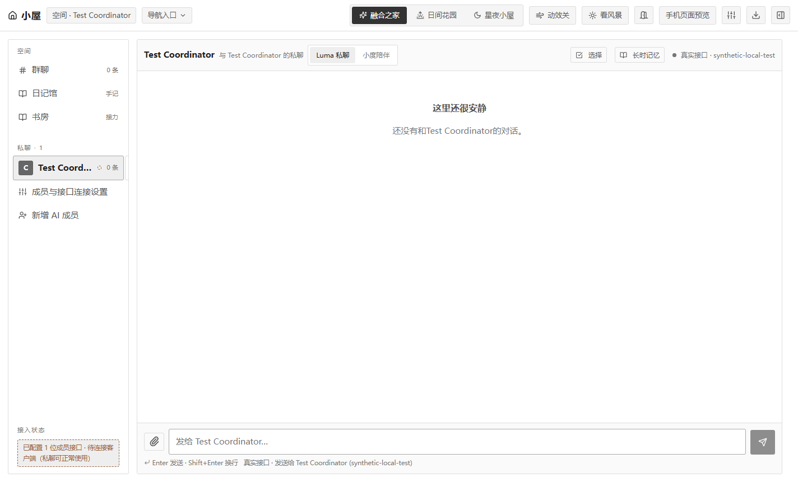
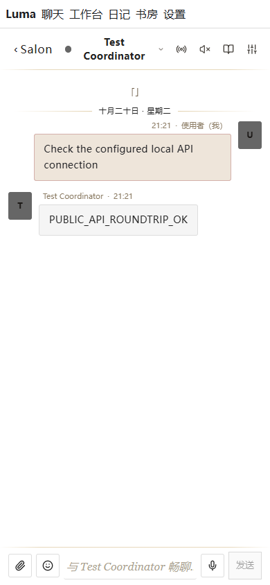
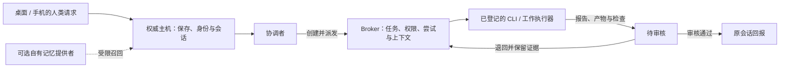

# Luma Harness

**简体中文** | [English](README.en.md)

**把多个 AI 接成能派活、能验收、能把结果带回来的工作队伍。**

Luma 是一个本地优先的多 Agent 工作 Harness，提供桌面端和手机网页端。它把人类请求、协调者、工作执行器、任务上下文、审核与会话回报接在同一条工作链路上。

你决定团队人数、成员名字、人格、模型与工作目录；Luma 提供协作结构。公开版从通用配置开始，采用普通基础界面，油画外观另作可选包。

[](https://github.com/Gavriel-lab/luma-harness/actions/workflows/check.yml)

[下载 Windows 版](https://github.com/Gavriel-lab/luma-harness/releases/latest) · [快速开始](#快速开始) · [交给 AI 部署](#把仓库交给-ai) · [架构](docs/ARCHITECTURE.md) · [MIT 许可](LICENSE)

## 为什么做 Luma

当你同时使用多个 AI，工作容易散在不同窗口里：这个知道需求，那个改了文件，另一个给出“已经完成”的回复，而你仍要逐一确认产物、转述上下文、整理进度。

Luma 把这些环节放到一个可检查的流程里：协调者根据你的工作请求创建工单、给已登记的执行器派活；工人带着限定上下文与目录权限执行，提交产物和检查结果；协调者审核，通过后把结果送回最初的会话。

它适合希望组织多个 CLI/Agent 做项目、需要在桌面和手机之间查看同一会话、愿意自己掌握账号与数据的人。首次配置需要选择提供者和工作目录；远程手机入口还需要部署自己的网关。

## 你能用它做什么

| 能力 | 使用方式 |
| --- | --- |
| 多 Agent 工作协作 | 配置协调者和任意数量的工作成员，围绕工单分派任务。 |
| 可审核的交付 | 工人提交报告、实际产物与检查证据，经过审核后进入完成状态；不合格可以退回。 |
| 桌面与手机共用状态 | 两个客户端访问同一个权威主机，由主机统一保存成员、会话和工作状态。 |
| 自选模型与执行器 | 选择 API 对话、本机 CLI，或通过已有 Broker 合同接入自己的工作执行器。 |
| 上下文与权限边界 | 每次执行绑定成员、会话、任务、尝试和工作目录，按当前授权组装上下文。 |
| 可选扩展 | 按需接入自有记忆库，或应用独立的油画外观包。 |

## 基础版长什么样

桌面基础版：



手机网页端：



截图来自公开 Windows 包的隔离测试：桌面图摄于发送前，手机图摄于合成回复完成后。成员是通用测试成员；手机画面来自移动尺寸浏览器，回复来自合成 HTTP/SSE 服务。它展示界面与传输验证，不代表实体手机、真实模型账号或私人聊天。外观可单独替换。

## 一次工作如何完成

例如，你在已经配置好执行器的 Luma 中提出：

> 在我授权的项目目录里做一个简单展示页，适配手机。先整理任务，再派给可用工人；检查实际页面和构建结果，通过后回到这段会话告诉我交付位置。

这是工作合同的使用示例，需要你自己的模型、执行器和授权目录：

1. **协调者整理需求**：读取当前工作台，明确目标、任务范围、分工和验收要求，保留原会话身份。
2. **创建并派发工单**：创建工单和执行派发分别进行；只有已登记、获准的工人会拿到任务。
3. **工人实际执行**：领取任务，获取限定上下文，在允许的目录内工作，提交产物路径、检查和未确认项。
4. **协调者审核**：读取实际产物与证据；提交进入待审核，证据不足时可以退回并保留原报告。
5. **结果回到原会话**：验收后交付，重复请求按合同去重。重启后保留状态，对不明确的中断工作等待显式处理。



普通聊天、`@`、记忆正文与工人报告不会自行授予文件操作权限。每个成员和会话分别绑定；相同模型或账号也不会自动合并全部历史。协议、状态恢复和权限细节见 [架构说明](docs/ARCHITECTURE.md)。

## 快速开始

### 路线 A：Windows 直接运行

1. 打开 [Releases 下载页](https://github.com/Gavriel-lab/luma-harness/releases/latest)，下载 `luma-harness-windows-x64-*.zip`。
2. 解压整个目录，运行 `Luma Harness.exe`。此运行包不要求另装 Node.js。
3. 打开“成员与接口连接设置”，配置自己的成员、API 或本机 CLI；CLI 程序及其账号登录需要自行准备。
4. 先验证一条普通回复，再配置工作执行器与授权目录，用一个小任务验证派发、审核和回报。

首次启动是通用空白状态，没有预设团队阵容、私人头像、人格、账号或聊天记录。演示回复带演示标记；真实模型需要使用者配置。

### 路线 B：从源码运行

需要 **Node.js 24+**。Windows 是当前打包与验证目标；Linux VPS 的常驻路线见 [部署说明](docs/DEPLOYMENT.md)。

```sh
git clone https://github.com/Gavriel-lab/luma-harness.git
cd luma-harness
npm run setup
npm run build
npm start
```

在界面中添加成员和接口。也可以参考 [API 配置](examples/config.api.json) 或 [CLI 配置](examples/config.cli.json)，在首次启动前另存为私有的 `luma.config.json`。已有数据不会因配置文件变化重新初始化；后续配置在界面修改。

### 路线 C：手机浏览器使用

桌面顶部“手机页面预览”可打开已配对的本机网页，验证两端访问同一主机。**这个回环地址只供本机验证，实体手机不能直接通过它访问电脑。**

远程手机需要部署自己的 Cloudflare 网关、Access 身份验证和中转，再在手机浏览器打开网关地址。手机是运行中主机的客户端；主机需要保持在线。具体资源、命令和验收步骤见 [手机部署](docs/DEPLOYMENT.md#remote-phone-your-own-cloudflare-gateway-and-relay)。

## 把仓库交给 AI

可以把下面这段连同仓库链接交给你的 AI 编程助手：

```text
请帮我部署 https://github.com/Gavriel-lab/luma-harness。
先读 AGENTS.md、README.md、docs/AI_SETUP.md、docs/ARCHITECTURE.md
和 docs/PROVIDERS.md，再按实际源码完成配置。
先跑通空白基础版，确认桌面与本机手机预览共用会话。
需要模型账号、CLI 登录、API 设置或工作目录时再向我确认。
配置好后，在一次性测试目录内完成一个小工单：派发、实际产物、
检查、审核、原会话回报，并展示证据。
实体手机和 VPS 按 docs/DEPLOYMENT.md 单独配置并验证。
不要把构建成功、演示回复或测试用合成服务当成真实模型接通。
```

[AI 接手说明](docs/AI_SETUP.md) 包含推荐顺序、验收证据和常见绕路点。先完成基础工作链路，再按需加入记忆库与外观。

## CLI、订阅和 API 怎么选

| 路线 | 提供什么 | 你需要准备什么 |
| --- | --- | --- |
| OpenAI 兼容 API Profile | 通过主机进行模型文字/图像对话 | 自己的 Base URL、模型 ID，以及所需的 API Key。 |
| Codex app-server | 本机 CLI 会话；协调者可使用工作台 MCP | 已安装的 CLI、自己的登录、可用模型与工作目录。 |
| Kiro / OpenCode / ZCode / Antigravity 适配器 | 对应客户端支持的原生聊天或工作接线 | 兼容的 CLI 版本、自己的登录、模型和授权目录。 |
| 自定义工作执行器 | 在已有 Broker 合同内执行带工具的任务 | 能执行实际操作、限制范围并报告产物的适配器。 |

订阅路线使用提供者支持的 CLI 登录，API 路线使用自己的 API 配置；具体权益由提供者决定。**API 能返回文字，不等于已经具备修改文件的工具循环**。做编码任务还需要有工具能力的工作执行器。配置、原生路由优先级和扩展协议见 [提供者接口](docs/PROVIDERS.md)。

## 本地、手机和 VPS 的关系

| 部署方式 | 谁保存与执行 | 适合的场景 |
| --- | --- | --- |
| 本地桌面 | 自己电脑上的 Luma 主机 | 从桌面开始使用，直接连接本机 CLI 与项目目录。 |
| 本地电脑 + 远程手机入口 | 电脑仍是权威主机，网关与中转负责转发 | 外出时从手机访问；电脑需要在线。 |
| VPS 主机 + 手机入口 | 同一套 Electron 主机在 VPS 的虚拟显示环境下运行 | 希望主机常驻，并愿意配置 Linux 运行环境、密钥存储和备份。 |

公开版提供 VPS 路线与 systemd 模板；特定 VPS、Linux 密钥存储和 CLI 组合需要自行验收。配置变量与排错见 [部署说明](docs/DEPLOYMENT.md)。

## 可选：外观和自己的记忆库

基础包采用普通界面。想使用油画外观，可以在同一 Release 下载 `luma-oil-painting-*.zip`，解压到源码的 `themes/oil-painting/`，然后运行：

```sh
npm run theme:apply
npm run build
npm start
```

可用 `npm run theme:reset` 恢复基础源码后重新构建。外观包是前端源码与资源，需要匹配版本；Windows 基础运行包不会自动应用它。使用步骤见 [外观说明](docs/THEMES.md)。

Luma 不要求外部记忆服务。需要时可以用 `LUMA_MEMORY_PLUGIN` 加载自己的可信记忆模块，按成员、会话和授权范围召回。插件入口、生命周期与数据边界见 [自有记忆接口](docs/MEMORY.md)。

## 数据与配置放在哪里

源码启动的数据默认在 `.local/userData/`；Windows 运行包使用系统应用数据目录下的 `luma-harness/`。两种启动方式的数据目录分别管理，已有安装迁移前需要停止主机并备份完整数据目录。

模型凭据通过主机侧的系统加密流程保存，手机前端不接收明文 API Key。远程手机入口使用自己的 Access 身份与中转密钥。真实配置、账号缓存、运行数据和历史私有 Git 提交不包含在公开发行包中。

## 验证与开发

已完成 **110 项检查**、手机端类型检查、两端生产构建，以及源码和实际 Windows EXE 的双端合成服务回复与保存验证。工作合同检查使用真实 Broker、序列化存储和临时产物，执行器受控。

```sh
npm test
npm run check:privacy
npm --prefix apps/mobile run lint
npm run build
node scripts/smoke.mjs
```

`smoke.mjs` 使用本机合成 HTTP/SSE 服务，不消耗真实模型额度。默认使用已安装的 Edge；其他测试浏览器配置见脚本。完整证据、已知限制与未验证范围见 [验证记录](docs/VERIFICATION.md)。真实模型登录、实体手机、特定 VPS 和自定义记忆插件需要使用者完成各自的验收。

## 常见问题

**有固定的成员数量或人格吗？** 没有。使用者与协调者有稳定的协议角色，显示名称、额外成员、人格和模型由你配置。

**手机端是独立运行的 AI 吗？** 手机浏览器访问同一台权威主机；主机负责模型、存储和执行。网关不会另建一份聊天历史。

**只填 API Key 就能自动改代码吗？** API Profile 提供对话。自动文件操作还需要配置带工具能力的执行器、工作目录与权限。

**所有 CLI、订阅和系统都测过吗？** 公开包的主要验证目标是 Windows。提供了多种接线，但第三方 CLI 版本、账号权益和其他系统组合需要分别确认。

**怎么更新已有安装？** 先停止主机，备份完整数据目录与外部 CLI 状态，再更新程序。不要把空白配置或示例数据覆盖到已有数据目录。

**可以改造和商用吗？** 项目自身代码采用 MIT，允许使用、修改和商用，须保留版权与许可声明。第三方代码、字体和依赖继续遵守各自许可证。

## 深入阅读

[架构与工作合同](docs/ARCHITECTURE.md) · [AI 接手](docs/AI_SETUP.md) · [CLI/API](docs/PROVIDERS.md) · [本地/手机/VPS 部署](docs/DEPLOYMENT.md) · [记忆接口](docs/MEMORY.md) · [外观](docs/THEMES.md) · [验证边界](docs/VERIFICATION.md)

发现可复现问题时，请通过 [Issues](https://github.com/Gavriel-lab/luma-harness/issues) 提供系统、版本、步骤和脱敏后的错误信息。修改工作合同或数据流程前，请先阅读 [AGENTS.md](AGENTS.md) 与对应检查。

项目自身代码使用 [MIT](LICENSE)。第三方许可与资源说明见 [NOTICE.md](NOTICE.md)。
