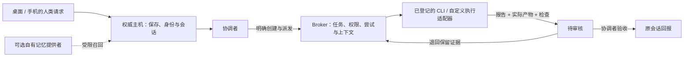

# Luma Harness

一个本地主机持有数据、多 Agent 协作、桌面与手机共用同一工作状态的工作 Harness。

重点是 **任务从哪里来、谁获准执行、带什么上下文、如何交付、谁验收、结果回到哪儿**。人数、成员名称、人格、模型和执行目录由使用者配置。基础发行版采用普通界面；油画外观是独立的可选包。

## 快速开始

需要 Node.js 24+。Windows 是当前打包目标；Linux VPS 的常驻路线见 [部署说明](docs/DEPLOYMENT.md)。

```sh
git clone https://github.com/Gavriel-lab/luma-harness.git
cd luma-harness
npm run setup
npm run build
npm start
```

首次启动只有空白的使用者和协调者两个协议角色，没有原有成员名单、人格或聊天记录。它们不规定你的团队人数。在“成员与接口连接设置”里添加成员，选择演示、API 或本机 CLI，再登记需要执行任务的客户端与工作目录。

默认不调用模型、不配置云账户、不启用外部记忆库。演示回复带演示标记。要接真实服务，填写自己的配置；可参照 [API 配置](examples/config.api.json) 和 [CLI 配置](examples/config.cli.json)，在首次启动前另存为 `luma.config.json`。已有数据不会因为配置文件变化被重置；后续在界面修改。

桌面顶部“手机页面预览”打开已配对的本机网页，使用同一主机和数据。**这个回环地址供本机验证；实体手机远程访问需要部署自己的网关与中转**，详见部署文档。

Windows Release 提供基础版运行目录压缩包。解压后运行 `Luma Harness.exe`，不需要另装 Node。CLI、账户登录和 API Key 仍由使用者自行提供。不要把空白发行版覆盖到自己的数据目录。

## 工作链路



- 复用同一 Broker；聊天与工作是不同作业类型。
- 普通聊天、`@` 或记忆正文不直接授权文件操作。
- 工人提交进入 `review`；提交不等于验收。
- 重复请求不重复执行；重启不会盲目重放模糊状态的工作。
- 每个成员、会话和线程分别绑定；相同模型或账户不等于共享全部历史。

## 接入与复现

| 需求 | 文档 |
| --- | --- |
| 把仓库交给 AI 部署 | [AI 接手说明](docs/AI_SETUP.md)、[AGENTS.md](AGENTS.md) |
| 理解调度、权限与回报 | [架构](docs/ARCHITECTURE.md) |
| CLI、API 与自定义工具适配器 | [提供者接口](docs/PROVIDERS.md) |
| 本地、Cloudflare 手机入口、Linux VPS | [部署](docs/DEPLOYMENT.md) |
| 自有记忆库 | [可选记忆接口](docs/MEMORY.md) |
| 使用独立油画美化包 | [外观](docs/THEMES.md) |
| 测试范围、限制和未验证项 | [验证记录](docs/VERIFICATION.md) |

API Profile 提供模型对话；自动修改文件还需要带工具能力的工作执行器。已带的原生客户端接线包括 Codex 协调者、Kiro、OpenCode、ZCode 和 Antigravity 适配器；具体 CLI 版本、登录、模型与平台支持由使用者确认。不要把“能返回文字”当作“能完成编码任务”。

## 开发与检查

```sh
npm test
npm run check:privacy
npm --prefix apps/mobile run lint
npm run build
node scripts/smoke.mjs
```

`smoke.mjs` 使用自己启动的合成 HTTP/SSE 服务验证两端与保存链路，不消耗真实模型额度。默认使用已安装的 Edge；Chrome 可设置 `LUMA_TEST_BROWSER=chrome`。测试数据留在 `.local/`，不会提交。

外部账户、凭据、`.local/`、运行数据、历史 Git 提交和原项目的私人记忆实现不包含在发行包中。
