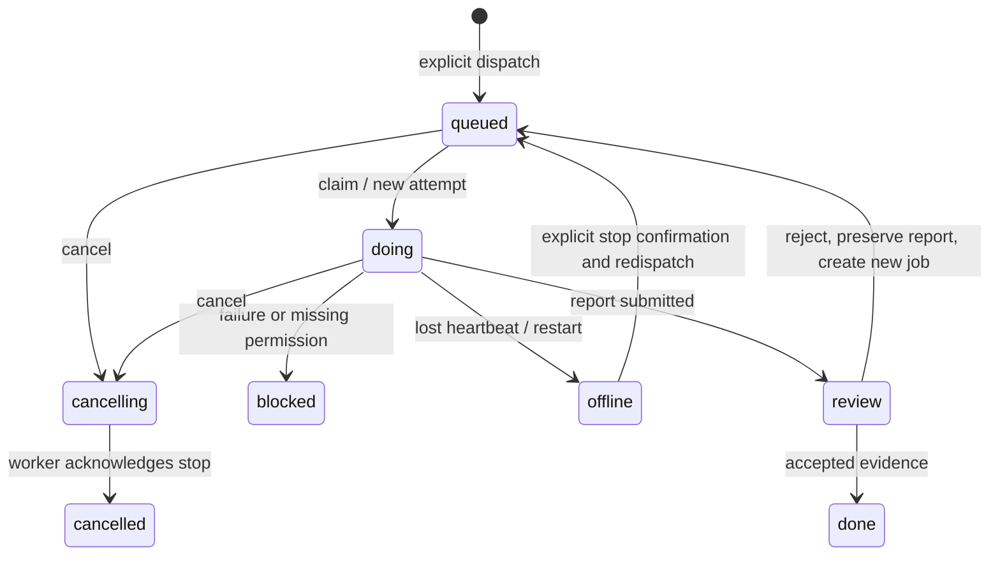

# Architecture and work contract

## v0.2 execution and acceptance

The [Pi SDK worker](PI.md) implements the existing claim/context/heartbeat/event/report contract with scoped read/write/edit/run tools and a host-side model forwarder. It does not own a second DataStore or scheduler. The host resolves the registered member's API Profile and credentials without cross-member fallback.

Collaborative plans have an explicit approval lifecycle: draft, human approval, dependency-based dispatch, worker review, coordinator internal acceptance, pending user acceptance, and final human completion. Only desktop user actions authorize plan approval or final acceptance; coordinator/model tokens are rejected for these operations. Partial revision preserves unaffected work, plan/attempt identities and evidence.

Work events remain in the backend report channel. Collaborative project handoffs notify the coordinator direct conversation; ordinary legacy tickets keep their original direct-conversation return. Recovery waits for renderer hydration and `authority:ready`/`bridge:ready`. Persisted sent messages with `requestId=rep_pub_<ticketId>` determine notification completion; a failed save must remain retryable.

## Components and ownership

| Component | Implementation | Responsibility |
| --- | --- | --- |
| Desktop renderer | `apps/desktop/src` | Conversations, members, tasks, settings, review, diary and study UI |
| Authoritative host | `apps/desktop/electron/main.cjs` | Trusted profile/context assembly, bounded IPC, model/service lifecycle |
| Persistent data | `electron/dataStore.cjs` | Serialized saves, revisions, recovery, thread bindings and tombstones |
| Work broker | `electron/bridgeBroker.cjs` | Registration, role-scoped credentials, context, jobs, attempts, reports and review |
| Managed launch | `electron/bridgeLauncher.cjs`, `connectors/bridge-entry.mjs` | Own executor children and stop only those processes |
| Coordinator tools | `connectors/coordinator.mjs` | MCP workbench operations available to the coordinator role |
| Model transport | `electron/chatService.cjs`, `codexService.cjs` | API SSE and Codex app-server transports |
| Mobile contract | `electron/mobileRelay.cjs` | MobileRpc: the same members, conversations, saves and reply jobs |
| Local mobile preview | `electron/localMobile.cjs` | Authenticated loopback HTTP adapter and built mobile assets |
| Public mobile gateway | `services/gateway` | Signed Access JWT verification, owner check, bounded operation forwarding |
| Relay | `services/relay` | Authenticated desktop WebSocket and request/response correlation |
| Mobile UI | `apps/mobile` | Responsive client; no provider credentials or separate model backend |

The host is the single source of truth. The cloud path forwards operations; it does not own a second chat history or write directly to the host's data file. The local preview also forwards the same MobileRpc operations.

## Identity and membership

`agent_owner` identifies the human owner. `agent_coordinator` identifies the coordinator capability. These protocol IDs are independent of displayed names. Additional AI IDs are arbitrary stable `agent_*` identifiers. Member settings add/remove members; runtime `/api/members` determines the mobile roster. There is no fixed worker count or persona assignment.

Each API Profile or native registration is separate from the member's identity. Native registrations with chat routing enabled take precedence over API Profiles for that member. A matching login/model does not merge conversations, thread history or memories.

## From a human request to delivered work

1. Persist the human request in its actual conversation. Derive user origin from that saved message rather than browser-supplied permission flags.
2. The coordinator reads the current workbench. A work ticket contains a goal, bounded tasks, assignees and acceptance criteria.
3. `create-ticket` saves through the authority mutation channel and verifies persistence. It does not execute anything.
4. `dispatch` creates a work job for a registered member and workspace. An ordinary conversation or `@` is not dispatch.
5. The registered executor claims the job. Broker issues a new `attemptId` and builds a bounded ContextPacket from current authority.
6. The worker requests context, sends heartbeats and ordered progress events, performs actual allowed operations, and reports artifact paths/checks/unknowns.
7. A successful worker submission enters review. The coordinator reads actual artifacts, checks evidence and either rejects that exact report/attempt or accepts it.
8. Acceptance can publish a result into the ticket's stored originating conversation. It retains the original request identity, strips protected paths/secrets, and deduplicates repeated delivery.

The coordinator MCP exposes `snapshot`, `create-ticket`, `connect`, `dispatch`, `artifact`, `reject-review`, `accept` and `cancel`. Mutations require an explicit decision, exact targets and a request ID. Instructions in a worker report do not grant coordinator permission.

## State and recovery

The diagram is a lifecycle explanation. Source enums additionally distinguish questions, permission requests and interrupted chat. Never rewrite source state names merely to match this illustration.

Jobs, attempts and reports are different identities. Duplicate POSTs deduplicate within their contract; reassigned tasks or changed authoritative context invalidate stale attempts. A restart rotates ephemeral executor tokens. Existing work is preserved and ambiguous interrupted work is not automatically rerun.

## Context and permissions

A ContextPacket binds home, generation, agent, executor, job, attempt, workspace, goal, scope, acceptance, identity, relevant discussion and authorized recall. Receipts describe what actually entered context. A changed or deleted source must not continue to authorize old context.

Chat execution and work execution have separate tool policies. Read-only/background turns do not inherit a preceding work turn's writable policy. Coordinator writes are restricted to the configured workspace. Native adapters enforce their own bounded tool policies as well; registration by itself is not proof that a third-party CLI applied a sandbox. Verify the chosen CLI version before real work.

The browser cannot read keys, invent provider endpoints for a turn, claim coordinator authority, access arbitrary local files or pass a self-selected writable-root list. The host resolves Profiles and saved user origin.

## Data layout

Source launches use `.local/userData/` unless `LUMA_DATA_DIR` is set. Standalone desktop builds use the OS app-data `luma-harness/` directory. Each authority has:

- `xiaowu-data/data.v1.json`: members, conversations, messages, tickets and preferences.
- `xiaowu-bridge/`: registration, job journal, short-lived protected session manifests/tokens.
- `luma-relay/`: owner-created relay address, home binding and token file.
- `local-mobile/`: local pairing URL/token; regenerated at host startup.
- Separate attachments, diary and study files managed by their services.

Back up a stopped host's whole data directory, not only the main JSON file. Never copy authentication caches into a public archive. A machine migration must decide explicitly how to re-authenticate provider credentials and retain any external CLI thread storage.
